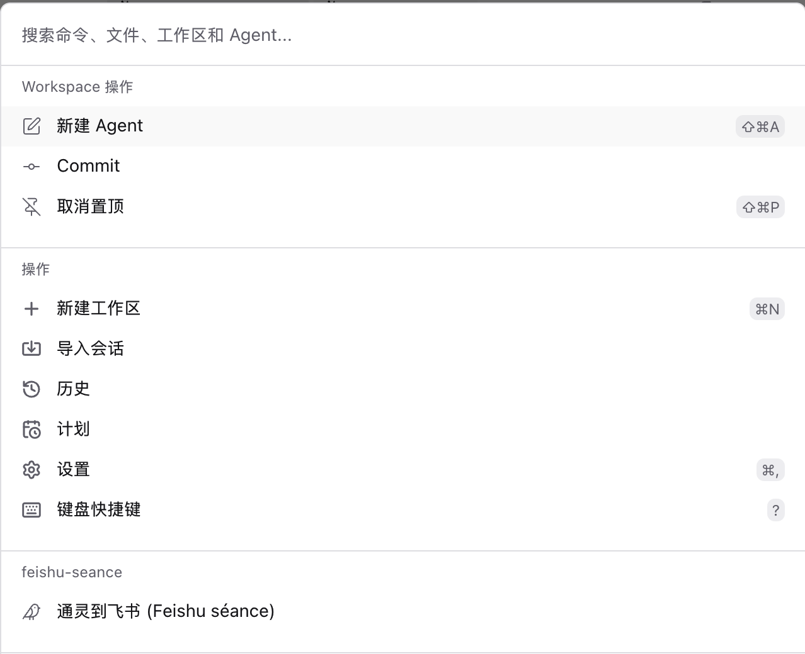
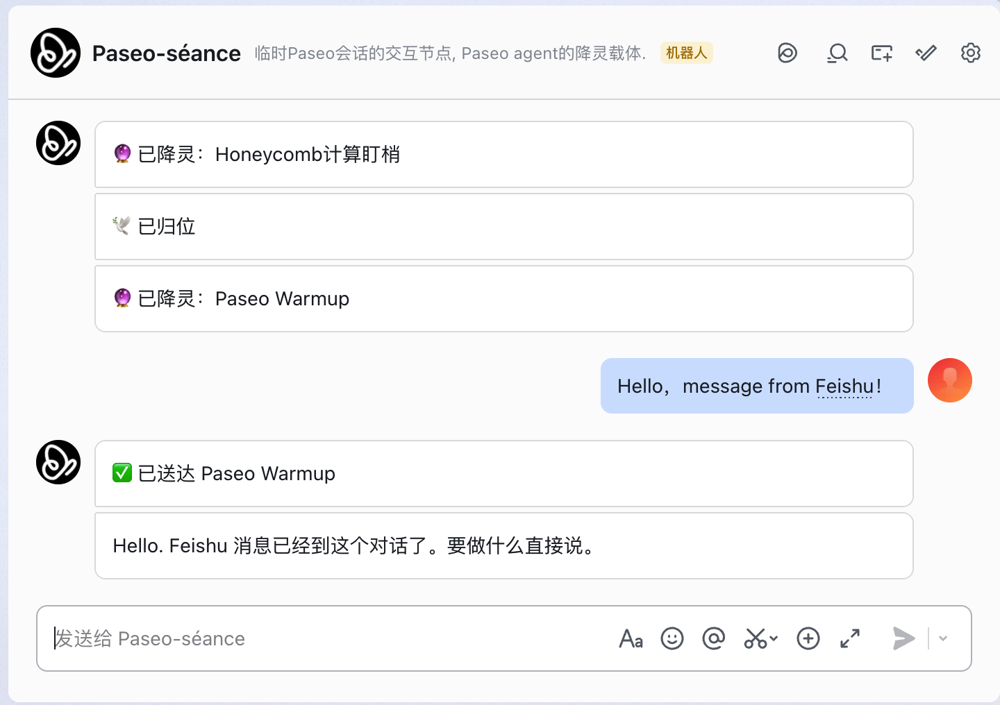
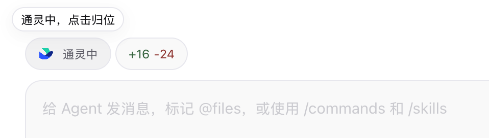

# paseo-feishu-seance

**Hold a séance for a running [Paseo](https://paseo.sh) agent.** One keystroke channels the session you are watching into a Feishu (Lark) bot — the agent's spirit descends into the chat (降灵), and you keep the conversation going from your phone while away from your desk. Its replies arrive in Feishu as rendered Markdown cards; messages you send the bot possess the session as prompts. When you are back, one tap on the composer pill sends the spirit home (归位).

> The Paseo plugin API is experimental. Requires Paseo **0.14.0** or newer; tested on 0.14.0.

## In action

**Start a séance from the command palette.** Open the agent you want to take with you and choose "通灵到飞书 (Feishu séance)" under ⌘K.



**Keep talking from Feishu.** The bot announces each séance and 归位 in your private chat. Messages you send it go to the agent as prompts, and the agent's reply comes back as a Markdown card.



**See which session is channeled.** A "通灵中" pill sits above the channeled session's composer. Tap it to end the séance (归位).



Screenshots captured from the Paseo desktop app and Feishu on macOS.

## What it does

- **降灵 / Channel**: **⌘K** → "通灵到飞书 (Feishu séance)" channels the focused agent. No window opens; the bot confirms in Feishu, and a "通灵中" pill appears above that session's composer. The pill shows up **only** on the channeled session — it is the occupancy indicator and one-tap 归位 (unbind). Unbound sessions carry no UI at all.
- **Outbound**: assistant messages are accumulated per turn and pushed to Feishu as a Card JSON 2.0 markdown card when the turn completes. Permission requests and turn failures are pushed as notifications.
- **Inbound**: plain text, images, and rich-text/image-mixed (`post`) messages sent to the bot are forwarded to the channeled agent via `send(text, { images })`. A message arriving mid-turn **interrupts** the running turn (same semantics as typing in the desktop client; client-side queueing is a UI feature the plugin bypasses). `/status` reports the current channel.
- **Dry-run mode**: without a Feishu config file, everything works except actual delivery — outbound messages go to the plugin log (`paseo plugin logs feishu-seance`).

## Security model (read this)

The bot is a **remote prompt channel into your machine**. Anyone whose messages reach the bot can drive the channeled agent with the agent's own permissions.

- Inbound messages are accepted only from `allowedChatIds` in the config. Keep it to your own private chat with the bot.
- Paseo plugin backend code runs unsandboxed on the daemon machine. `appSecret` never leaves the daemon side.

## Feishu app setup

You need a self-built (企业自建) Feishu app:

1. [open.feishu.cn](https://open.feishu.cn) → Developer console → create an enterprise self-built app. Note the **App ID** and **App Secret**.
2. Add the **Bot** capability.
3. Permissions: `im:message`, `im:message:send_as_bot`.
4. Event subscription: choose **long connection** (使用长连接接收事件) — no public webhook needed — and subscribe to `im.message.receive_v1`.
5. Create a version and publish (may require tenant admin approval).
6. In the Feishu client, open a private chat with the bot and send any message once.

The `chatId` of that private chat is not shown in the client UI. Bootstrap trick: set `chatId` to a dummy value, reload the plugin, start a séance (the long connection is only held while channeled), send the bot a message, and read the real `oc_...` id from `paseo plugin logs feishu-seance` (`rejected message from non-whitelisted chat: oc_...`).

## Install

```bash
paseo plugin add wangfh5/feishu-seance
```

The install runs `npm ci --omit=dev --ignore-scripts` in the plugin checkout to fetch the Feishu SDK from the lockfile. To work on a local checkout instead:

```bash
git clone https://github.com/wangfh5/paseo-feishu-seance.git && cd paseo-feishu-seance
npm install
npm run typecheck
paseo plugin add /absolute/path/to/paseo-feishu-seance
```

Then create `~/.paseo/feishu-seance.config.json` from [feishu-seance.config.example.json](feishu-seance.config.example.json) (the legacy name `feishu-relay.config.json` is still read as a fallback):

| Field | Meaning |
| --- | --- |
| `appId` / `appSecret` | Feishu app credentials |
| `chatId` | Outbound target chat (your private chat with the bot) |
| `allowedChatIds` | Inbound whitelist; defaults to `[chatId]` |

Reload after changing the config: `paseo plugin reload feishu-seance`.

## Usage

1. Open an agent tab, **⌘K** → "通灵到飞书 (Feishu séance)". The bot confirms in Feishu (🔮 已降灵), and the "通灵中" pill appears on that session.
2. Every completed turn is pushed to Feishu as a card.
3. Reply in Feishu to steer the agent. Send `/status` to check the current channel.
4. Tap the pill to 归位, close/archive the channeled session, or channel another session to move the séance. Archiving the session (closing its window) also 归位 and the bot confirms in Feishu.

### Multiple daemons

You can install the plugin on several daemons with the same bot. Feishu's long connection is **cluster mode, not broadcast**: when several clients share one app, each inbound event is delivered to a *random* one of them. The plugin therefore only holds a connection while channeled (降灵) — an idle daemon stays offline and can no longer swallow prompts meant for the channeled one. Discipline is still the protocol for the remaining race: 归位 the current session before channeling another daemon's session, or both hold connections and inbound prompts split randomly between them.

## Known limitations

- After a plugin reload or daemon restart, the timeline and archive watches are rebuilt lazily on the first RPC (the pill's sync loop triggers it within 5 s; re-channeling works too). Turns completed in that gap are not pushed.
- The bot is offline while nothing is channeled (the long connection is only held during a séance): messages sent then, including `/status`, get no reply.
- Feishu's long connection is at-least-once: events not acked (e.g. while the plugin was wedged) are redelivered later. There is **no `message_id` dedup yet** — a stale message can arrive as a fresh prompt after recovery.
- Permission requests are push-only; approval still requires the desktop client.
- Tool calls are counted, not detailed; very long replies are not split.

## Dev notes (battle scars)

- Paseo bundles the server entry with esbuild (including `@larksuiteoapi/node-sdk`) and evaluates it in a scope without `__dirname`. The SDK reads `__dirname` while loading to find its own `package.json` for the User-Agent, so the plugin sets a placeholder `__dirname` and then lazily `require`s the SDK. An old config's `pluginDir` field is now ignored.
- Server code must not import `@getpaseo/client` at runtime, not even for types: Git installs skip devDependencies and the bundler fails to resolve it. Event types are derived from the plugin SDK instead.
- `assistant_message` stream events are provider-dependent: some providers send deltas, others cumulative text. Aggregation uses a prefix heuristic (new text starts with the buffered text → replace, else append).
- Feishu inbound is not just `text`: quoted messages and image+text mixes arrive as `post` (rich-text JSON). Images are downloaded via `im.message.resource` and forwarded base64-encoded.
- With a live WS client/subscription, the daemon's plugin stop can hang (`Stopping plugin` forever, queueing all later lifecycle commands). The contribution cleanup closes the WS client (`WSClient.close()`, public since lark SDK 1.73) and force-exits the subprocess as a belt-and-braces fallback.
- Plugin RPCs cannot be invoked from external scripts: the `@getpaseo/client` bundle validates outbound messages against an older embedded protocol schema that lacks `plugin.rpc.invoke.request`.

Similar projects worth stealing ideas from: [opencode-feishu](https://github.com/NeverMore93/opencode-feishu) (CardKit 2.0 streaming cards, card-button approvals), [pi-feishu-lark](https://github.com/AX1202/pi-feishu-lark), [dsh-bridge](https://github.com/wenbin-wb/dsh-bridge).

## License

[MIT](LICENSE)
